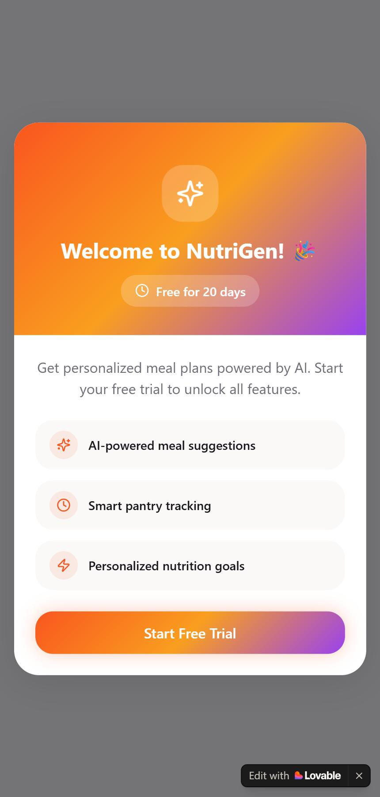
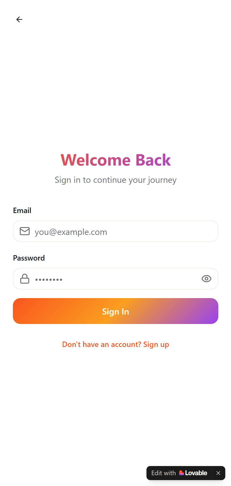

<div align="center">

# 🥗 NutriGen — Daily Plate Perfect

**A mobile-first meal planner that personalises your day around your goals, your diet and your schedule.**

[](https://nutri-gen-app.lovable.app)



&nbsp;&nbsp;


</div>

---

## Why NutriGen?

Most calorie trackers feel like spreadsheets. NutriGen is designed the other way round: a clean, friendly, Gen Z–oriented app that works on any device and bends around how *you* eat, with flexible meal times, dietary preferences, health goals and a pantry that helps decide what to cook.

> **Try it without signing up.** Tap **Try the demo** on the welcome screen to explore every feature with a pre-filled pantry and a week of meals. It's fully editable and stays in your browser. Creating an account saves your own data to the cloud.

## Features

- 🧭 **Onboard first, sign up later**: four quick steps (goal, diet, meal times) *before* creating an account, so the app is personalised from the first screen. Answers are saved to your profile when you sign up.
- 🎁 **20-day free trial** that starts when you create your account (no card required)
- 🔐 **Real accounts**: email sign-up with confirmation, sign-in, forgot/reset password, persistent sessions, and clear messages for every failure (wrong password, unconfirmed email, existing account)
- 📊 **Live dashboard**: calorie ring and macro targets computed from your daily goal, meals you logged today, a real logging streak, a 7-day average, and a water tracker
- 🍽️ **Smart meal ideas**: recipes for breakfast, lunch, dinner and snacks, filtered by your diet (vegetarian, vegan, gluten-free, dairy-free, keto, halal) and ranked by what's already in your pantry and the calories you have left
- 📸 **AI pantry scan**: open the camera view (or pick a photo) on your groceries, fridge or a receipt, tap once, and Gemini lists what it sees, each item with a category, quantity and estimated expiry date. Review, tweak, add everything in one tap
- ✨ **Auto-fill** (a switch in Preferences): type "paneer" and its category, unit and expiry date fill themselves in. Common foods are filled instantly from built-in knowledge; unusual ones are looked up by the AI
- 🤖 **AI meal ideas**: one tap for three recipes made for your diet, your pantry (expiring items first) and the calories you have left today, ready to log
- 🥕 **Pantry that works**: add, search and remove items; expiry dates drive "use these first" alerts; items you have are highlighted on recipes
- ➕ **Quick logging**: one tap from a suggestion, a recipe or the library, or add your own custom meal with calories and macros
- 🕘 **Meal history**: browse any day, filter by meal type, search, and remove entries
- 🎯 **Personalised targets**: a calorie estimate from your height, weight, age, activity and goal (Mifflin-St Jeor), which you can accept or override
- ✨ **Polished UX**: animated splash, smooth transitions, bottom navigation, dark mode, responsive layout

> The recipe list on the Meals tab uses transparent rules (diet, pantry match, calories); the AI features sit on top of it and the app keeps working if the AI is off. AI output is an estimate: calories, expiry dates and allergens should always be double-checked. Paleo and kosher can't be verified from recipe data, so the app says so instead of guessing.

## How it works

```
Splash ─▶ Welcome ─▶ Onboarding (4 steps) ─▶ Free trial ─▶ Create account ─▶ App
              │                                                             │
              ├─▶ Try the demo (no account) ────────────────────────────────┤
              └─▶ Sign in (returning users) ────────────────────────────────┘
                                   Dashboard · Meals · Pantry · Profile ◀───┘
```

- Onboarding answers are held in the browser until the account exists, then written to the new profile (even if you confirm your email later).
- Routes are protected: signed-out visitors are sent to `/auth`; signed-in users who haven't finished onboarding are sent to `/onboarding`.
- **Demo mode** swaps the cloud database for a browser-local store with the same shape, so every screen behaves identically.

## Tech stack

| Layer | Tools |
| --- | --- |
| Framework | React 18, TypeScript, Vite |
| UI | Tailwind CSS, shadcn/ui (Radix UI), Lucide icons |
| Motion | Framer Motion |
| Data / state | TanStack Query, React Hook Form + Zod |
| Backend | Supabase (Postgres, Auth, Row Level Security) |
| Tooling | ESLint, Vitest, bun / npm |

## Data model

Defined in [`supabase/migrations`](supabase/migrations). Row Level Security is enabled on every table, so each user can only read and write their own rows.

| Table | Purpose |
| --- | --- |
| `profiles` | Body stats, goal, diet, allergies, meal times, calorie target, trial and onboarding state. Created automatically by a database trigger at sign-up. |
| `pantry_items` | Ingredients with category, quantity, unit and expiry date |
| `meal_logs` | Logged meals with calories and macros |
| `health_streaks` | Reserved for streak history (streaks are currently computed from `meal_logs`) |

## Getting started

**Prerequisites:** Node.js 18+ (or bun) and a free [Supabase](https://supabase.com) project.

```bash
# 1. Clone and install
git clone https://github.com/Himanshu-moderator/nutri-gen-app.git
cd nutri-gen-app
npm install            # or: bun install

# 2. Configure environment (see below)
cp .env.example .env

# 3. Run
npm run dev            # http://localhost:8080
```

**Environment variables** (from your Supabase project's *Settings → API*):

```env
VITE_SUPABASE_URL=https://<your-project>.supabase.co
VITE_SUPABASE_PUBLISHABLE_KEY=<your-anon-public-key>
VITE_SUPABASE_PROJECT_ID=<your-project-id>
```

Apply the schema from `supabase/migrations/*.sql` (via the Supabase SQL editor or `supabase db push`) so the tables, policies and sign-up trigger exist.

**Enable the AI features (optional)**

The AI runs in a Supabase Edge Function, [`supabase/functions/nutrigen-ai`](supabase/functions/nutrigen-ai), so the Gemini API key stays on the server and is never shipped to the browser. Without it the app still works: auto-fill uses built-in food knowledge and the AI buttons explain they're unavailable.

```bash
supabase login
supabase link --project-ref <your-project-id>
supabase secrets set GEMINI_API_KEY=<your-gemini-api-key>   # from https://aistudio.google.com/apikey
supabase functions deploy nutrigen-ai
```

Set a daily quota on the Gemini key in Google AI Studio / Cloud Console: the function is callable by anyone who can open the app (including demo mode), so a cap bounds the cost. Optionally set `GEMINI_MODEL` to choose a different model.

**Scripts**

| Command | What it does |
| --- | --- |
| `npm run dev` | Start the dev server |
| `npm run build` | Production build |
| `npm run preview` | Preview the production build |
| `npm run lint` | Lint the codebase |
| `npm test` | Run unit tests (nutrition maths, recipe engine, demo store) |

## Project structure

```
src/
├── pages/         Index, Onboarding, Trial, Auth, Dashboard, Meals, Pantry, Profile…
├── components/    CalorieRing, MacroCard, MealCard, AddMealSheet, SplashScreen, ui/ (shadcn)
├── contexts/      AuthContext (Supabase session or demo mode)
├── hooks/         useProfile, useMealLogs, usePantry, useWater…
├── integrations/  Supabase client and generated types
├── lib/           Nutrition maths, recipe engine, demo store (with unit tests)
└── data/          Built-in recipe library
supabase/          Migrations and config
```

## Roadmap

- [ ] Rate limiting and per-user AI quotas
- [ ] Real nutrition data per serving (today's recipe library is built in)
- [ ] Allergy selection that filters recipes (the column already exists)
- [ ] Reminders and notifications around each user's meal times
- [ ] Profile photos
- [ ] Subscription flow after the 20-day trial
- [ ] Google sign-in

## About

Designed and built by **[Himanshu Chatterjee](https://github.com/Himanshu-moderator)** as part of a move into product management: from the product brief and feature scoping to the UX flows and the working app. Prototyped with [Lovable](https://lovable.dev).

Feedback and ideas are welcome — open an issue.
