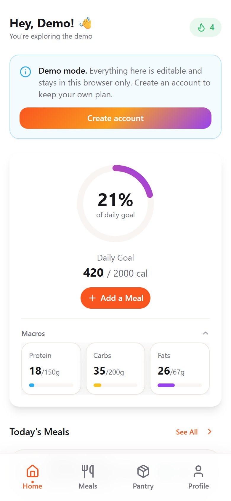
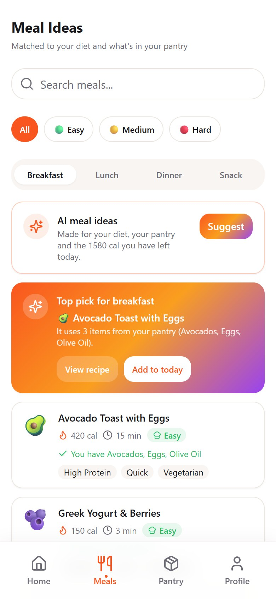
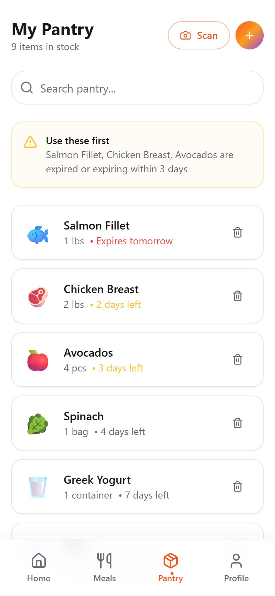
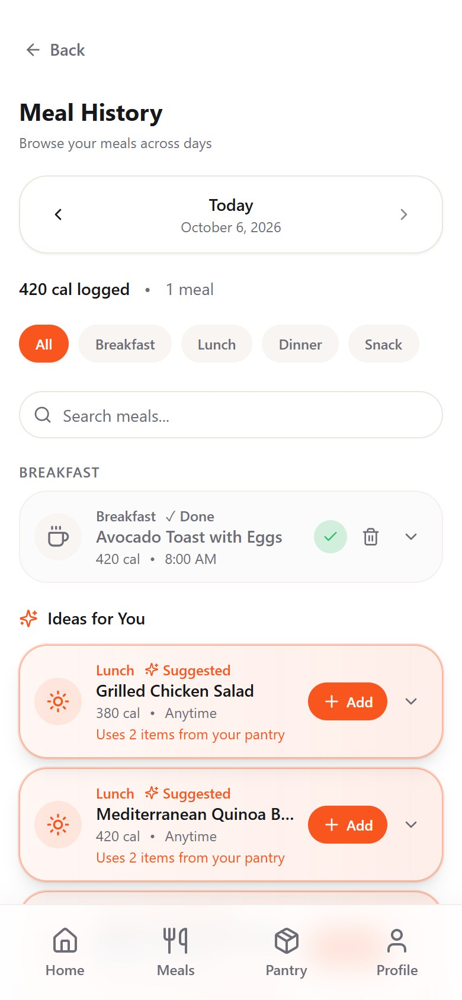

<div align="center">

# 🥗 NutriGen

### Daily Plate Perfect: a meal planner that bends around *your* day

<a href="https://nutri-gen-app.lovable.app"></a>&nbsp;
<a href="docs/NutriGen-Prototype-Case-Study.pdf"></a>

<sub>No account needed. Open the demo and tap <b>Try the demo</b> on the first screen.</sub>

<br/>
<br/>

<table>
  <tr>
    <td align="center"><br /><sub><b>Welcome</b></sub></td>
    <td align="center"><br /><sub><b>Home</b></sub></td>
    <td align="center"><br /><sub><b>Meals</b></sub></td>
    <td align="center"><br /><sub><b>Pantry</b></sub></td>
    <td align="center"><br /><sub><b>History</b></sub></td>
  </tr>
</table>

<br/>


</div>

---

## 🚀 Try it in 30 seconds

1. Open the **[live demo](https://nutri-gen-app.lovable.app)**.
2. Tap **Try the demo**. There's no sign-up, and everything stays in your browser.
3. Poke around:
   - **Home**: log a meal and watch the calorie ring and macros move
   - **Meals**: recipes matched to your diet and what's in your pantry
   - **Pantry**: see what's about to expire, add items, or **Scan** groceries with the camera
   - **History**: browse any day, filter by meal type, search

The demo comes pre-filled with a pantry and a few days of meals, and it's fully editable. **Create account** from inside the demo when you want to keep your own plan.

## 📄 The product story

NutriGen began as a **product case study**: I researched why meal-planning apps lose people, wrote the problem statements, mapped the key user flows, and designed a prototype. This repo is the working app that came out of it.

**[Read the full case study (PDF) →](docs/NutriGen-Prototype-Case-Study.pdf)**

It covers the user research, six pain points, three problem statements, three key flows and the prototype UI. Here's how the app answers what the research found:

| What users struggle with | How NutriGen responds | Status |
| --- | --- | :---: |
| **Vanishing data**: plans lost when an app only saves on the phone | Real accounts with cloud storage, so your profile, pantry and meals follow you across devices | ✅ |
| **Numbers they can't trust**: wrong calorie maths | Targets from a standard formula (Mifflin-St Jeor), macros summed from what you log, and the nutrition maths is covered by unit tests. Recipe calories come from a built-in library; verified nutrition data is still to do | ✅ / 🔜 |
| **Pay-to-play walls** | Nothing is locked. A 20-day trial is tracked, but paid plans aren't built, so every feature works | ✅ |
| **Ad fatigue and "trap" buttons** | No ads, no redirects, one clean flow | ✅ |
| **Slow onboarding** | Four quick steps *before* sign-up, or skip sign-up entirely with the demo | ✅ |
| **Planning around what's in the kitchen** | Pantry with expiry alerts, recipes ranked by pantry match, AI meal ideas and an AI pantry scan | ✅ |
| **Rigid schedules** | Log, browse and remove meals day by day in History. The drag-and-drop weekly planner from the case study isn't built yet | 🔜 |

> A few things sketched in the case study (budget mode, phone verification, profile photos) aren't in this build. The roadmap at the bottom lists what's next.

## ✨ Features

**Get going fast**
- 🧭 **Onboard first, sign up later**: four quick steps (goal, diet, meal times) *before* creating an account, saved to your profile when you sign up
- 🎁 **20-day free trial** from sign-up, no card required
- 🔐 **Real accounts**: email sign-up with confirmation, sign-in, password reset, persistent sessions and clear messages for every failure

**Plan your day**
- 📊 **Live dashboard**: calorie ring and macro targets, today's meals, a real logging streak, a 7-day average and a water tracker
- 🍽️ **Smart meal ideas**: recipes by meal type, filtered by diet (vegetarian, vegan, gluten-free, dairy-free, keto, halal) and ranked by your pantry and the calories you have left
- ➕ **Quick logging**: one tap from a suggestion or recipe, or add your own meal with calories and macros
- 🕘 **Meal history**: browse any day, filter by meal type, search and remove entries
- 🎯 **Personalised targets**: a calorie estimate from height, weight, age, activity and goal, which you can accept or override

**Cook from what you have**
- 🥕 **Pantry that works**: add, search and remove items; expiry dates drive "use these first" alerts, and recipes highlight what you already own
- 📸 **AI pantry scan**: point the camera (or pick a photo) at groceries, your fridge or a receipt. Gemini lists what it sees with a category, quantity and estimated expiry, and you review and add everything in one tap
- ✨ **Auto-fill**: type "paneer" and its category, unit and expiry fill themselves in. Common foods are instant from built-in knowledge; unusual ones are looked up by the AI (a switch in Preferences)
- 🤖 **AI meal ideas**: one tap for three recipes made for your diet, your pantry (expiring items first) and today's remaining calories

**Feels good to use**
- 🎨 Animated splash, smooth transitions, bottom navigation, dark mode and a responsive layout

> The Meals tab ranks recipes with transparent rules (diet, pantry match, calories); the AI features sit on top and the app keeps working if the AI is off. AI output is an estimate, so calories, expiry dates and allergens should always be double-checked. Paleo and kosher can't be verified from recipe data, so the app says so instead of guessing.

## 🧭 How it works

```
Splash ─▶ Welcome ─▶ Onboarding (4 steps) ─▶ Free trial ─▶ Create account ─▶ App
              │                                                             │
              ├─▶ Try the demo (no account) ────────────────────────────────┤
              └─▶ Sign in (returning users) ────────────────────────────────┘
                                   Dashboard · Meals · Pantry · Profile ◀───┘
```

- Onboarding answers are held in the browser until the account exists, then written to the new profile (even if you confirm your email later).
- Routes are protected: signed-out visitors go to `/auth`, and signed-in users who haven't finished onboarding go to `/onboarding`.
- **Demo mode** swaps the cloud database for a browser-local store with the same shape, so every screen behaves identically.

## 🧱 Tech stack

| Layer | Tools |
| --- | --- |
| Framework | React 18, TypeScript, Vite |
| UI | Tailwind CSS, shadcn/ui (Radix UI), Lucide icons |
| Motion | Framer Motion |
| Data / state | TanStack Query, React Hook Form + Zod |
| Backend | Supabase (Postgres, Auth, Row Level Security, Edge Functions) |
| AI | Google Gemini, called from a Supabase Edge Function so the key stays on the server |
| Tooling | ESLint, Vitest, bun / npm |

## 🛠️ For developers

<details>
<summary><b>Run it locally</b></summary>

<br/>

**Prerequisites:** Node.js 18+ (or bun) and a free [Supabase](https://supabase.com) project.

```bash
# 1. Clone and install
git clone https://github.com/Himanshu-moderator/nutri-gen-app.git
cd nutri-gen-app
npm install            # or: bun install

# 2. Configure environment
cp .env.example .env

# 3. Run
npm run dev            # http://localhost:8080
```

**Environment variables** (from your Supabase project's *Settings → API*):

```env
VITE_SUPABASE_URL=https://<your-project>.supabase.co
VITE_SUPABASE_PUBLISHABLE_KEY=<your-anon-public-key>
VITE_SUPABASE_PROJECT_ID=<your-project-id>
```

Apply the schema from `supabase/migrations/*.sql` (via the Supabase SQL editor or `supabase db push`) so the tables, policies and sign-up trigger exist. Demo mode needs none of this.

| Command | What it does |
| --- | --- |
| `npm run dev` | Start the dev server |
| `npm run build` | Production build |
| `npm run preview` | Preview the production build |
| `npm run lint` | Lint the codebase |
| `npm test` | Run unit tests (nutrition maths, recipe engine, demo store) |

</details>

<details>
<summary><b>Enable the AI features (optional)</b></summary>

<br/>

The AI runs in a Supabase Edge Function, [`supabase/functions/nutrigen-ai`](supabase/functions/nutrigen-ai), so the Gemini API key is never shipped to the browser. Without it the app still works: auto-fill uses built-in food knowledge and the AI buttons say they're unavailable.

```bash
supabase login
supabase link --project-ref <your-project-id>
supabase secrets set GEMINI_API_KEY=<your-gemini-api-key>   # from https://aistudio.google.com/apikey
supabase functions deploy nutrigen-ai
```

Set a daily quota on the Gemini key in Google AI Studio / Cloud Console: the function is callable by anyone who can open the app (including demo mode), so a cap bounds the cost. Optionally set `GEMINI_MODEL` to choose a different model.

</details>

<details>
<summary><b>Data model</b></summary>

<br/>

Defined in [`supabase/migrations`](supabase/migrations). Row Level Security is enabled on every table, so each user can only read and write their own rows.

| Table | Purpose |
| --- | --- |
| `profiles` | Body stats, goal, diet, allergies, meal times, calorie target, trial and onboarding state. Created automatically by a database trigger at sign-up |
| `pantry_items` | Ingredients with category, quantity, unit and expiry date |
| `meal_logs` | Logged meals with calories and macros |
| `health_streaks` | Reserved for streak history (streaks are currently computed from `meal_logs`) |

</details>

<details>
<summary><b>Project structure</b></summary>

<br/>

```
src/
├── pages/         Index, Onboarding, Trial, Auth, Dashboard, Meals, Pantry, Profile…
├── components/    CalorieRing, MacroCard, MealCard, PantryScan, CameraScanner, ui/ (shadcn)
├── contexts/      AuthContext (Supabase session or demo mode)
├── hooks/         useProfile, useMealLogs, usePantry, useWater…
├── integrations/  Supabase client and generated types
├── lib/           Nutrition maths, recipe engine, demo store, AI client (with unit tests)
└── data/          Built-in recipe library
supabase/          Migrations, config and the nutrigen-ai edge function
docs/              Case study PDF and screenshots
```

</details>

## 🗺️ Roadmap

- [ ] Drag-and-drop weekly planner (from the case study)
- [ ] Budget mode: meal suggestions tailored to a weekly budget
- [ ] Verified nutrition data per serving (today's recipe library is built in)
- [ ] Allergy selection that filters recipes (the column already exists)
- [ ] Reminders and notifications around each user's meal times
- [ ] Rate limiting and per-user AI quotas
- [ ] Profile photos
- [ ] Subscription flow after the 20-day trial
- [ ] Google sign-in

## 👤 About

Designed and built by **[Himanshu Chatterjee](https://github.com/Himanshu-moderator)** as part of a move into product management: from the research and problem statements to the UX flows and the working app. Prototyped with [Lovable](https://lovable.dev).

Feedback and ideas are welcome. [Connect on LinkedIn](https://www.linkedin.com/in/himanshu-chatterjee-386684267) or open an issue.
